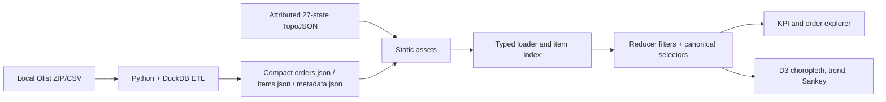

# Technical Architecture — canonical POC v2

## Purpose and boundaries

A **local-only static React + TypeScript + Vite SPA** loads compact, validated order and item facts generated by a reproducible **Python + DuckDB** offline transform. React owns state and SVG markup; D3 provides geometry, scales and Sankey layout. No runtime backend, SQL server, API, geocoding, GPS, or routing. Both dark and light themes are P0 (dark default), seller-origin choropleth is the default view, and purchase-date filter is initially unset (all valid historical dates).



## Approved dependencies

| Concern | Choice | Constraint |
|---|---|---|
| UI | React + TypeScript + Vite | No Next.js, backend, or routing framework |
| Styling | Tailwind + semantic CSS variables | One theme attribute, both modes tested |
| Charts | D3 modules, `d3-sankey`, `d3-geo`, `topojson-client` | React renders SVG; D3 computes layouts |
| Tabular explorer | `@tanstack/react-table` | Client-side paginated cohort |
| Offline ETL | Python 3.12 + DuckDB | One SQL-backed preparation path; no mandatory Pandas |
| Tests | Vitest + React Testing Library + Python assertions | Manual browser acceptance P0; Playwright deferred |
| Runtime data | Static JSON and TopoJSON | Full compact facts may load upfront for cross-filtering |

Use compatible stable dependency versions checked during implementation and commit a lockfile.

## Canonical repository layout

```text
commerce_dashboard/
  AGENTS.md
  README.md
  docs/
    ARCHITECTURE.md
    PRODUCT_AND_FEATURES.md
    DATA_SPECIFICATION.md
    VISUALIZATION_AND_UX.md
    IMPLEMENTATION_PLAN.md
    TESTING_AND_ACCEPTANCE.md
    DECISIONS_AND_RISKS.md
    WORK_UNITS.md
  data/raw/                  # gitignored Olist ZIP + extracted files
  data/processed/            # gitignored local intermediates and reports
  scripts/prepare_data.py
  scripts/validate_data.py   # optional convenience wrapper
  public/data/               # gitignored source-derived orders/items/metadata
  public/geo/                # approved and attributed state-level TopoJSON
  src/
    app/                    # App, useReducer filter state, theme provider
    domain/                 # shared types, metric definitions, selectors
    data/                   # loader, validators, indexes
    components/             # cards, filters, shared UI
    charts/                 # BrazilMap, ShippingSankey, DeliveryTrends
    features/orders/        # table + detail panel
    styles/                 # tokens and global CSS
    main.tsx
  tests/fixtures/
  package.json
  vite.config.ts
```

**Single source of truth:** types, cohort rules, metrics and selectors belong in `src/domain/`. `src/data/` loads, validates and indexes data but **does not recompute business formulas**. `src/app/` owns interactions; `src/charts/` receives typed view models and emits actions.

## Canonical filter and focused-flow state (WU-05)

The earlier single-select state contract has been **superseded** by WU-05. The checked-in 
`src/domain/types.ts` and `src/app/filterReducer.ts` are normative:

```ts
interface FlowPair { sellerState: string; customerState: string }
interface Filters {
  purchaseDateFrom: string | null; purchaseDateTo: string | null;
  customerStates: readonly string[]; // [] = all, OR within group
  sellerStates: readonly string[];   // [] = all, OR within group
  categories: readonly string[];    // [] = all, OR within group
  focusedFlow: FlowPair | null;     // context-preserving drill-down, not a dimension selection
}
type MultiDimension = 'customerStates' | 'sellerStates' | 'categories';
type FilterAction =
  | {type:'set_date_range'; from:string|null; to:string|null}
  | {type:'toggle_value'; dimension:MultiDimension; value:string}
  | {type:'clear_dimension'; dimension:MultiDimension}
  | {type:'focus_flow'; sellerState:string; customerState:string}
  | {type:'clear_flow_focus'}
  | {type:'clear_all'};
```

Group membership is **OR within each group, AND across dimensions**, with seller and category evaluated **on the same item**. A focus adds an exact directed source–destination item-pair constraint to metrics and order explorer *without* changing the broader context filters or the Sankey layout. If global seller/customer selections no longer include the focus, the reducer clears it. The 27-state map uses a **self-dimension-excluded context** to keep other states visible and addable. The trend retains the historical X-axis and shows a focused overlay when applicable. See `docs/WU05_SPEC.md`.

## Selector/data ownership

On initial load, validate the schemaVersion and each dataset, build `Map<orderId, ItemFact[]>` once, and retain typed arrays. With arbitrary combinations of seller/category/date/destination filters, **both compact order and item facts are required for correct cross-filtering**. Do not present static aggregates as dynamically filterable. Do not emit `geo-flows.json` for P0; calculate bounded state flows from matched items. Calculate each selected order once, aggregate only matching items for item-value/freight metrics. Keep derived view models memoized by relevant filter inputs.

For the trend chart alone, preserve a **stable full-history X-axis** under current non-date filters while showing/highlighting months within the active date range; this intentionally differs from the date-filtered KPI cohort and must be labeled as context. See `VISUALIZATION_AND_UX.md`.

## Performance guardrails

Measure actual `orders.json` / `items.json` byte size, loading/parsing time and filter latency on the developer machine. Don't claim arbitrary estimated sizes or timings. Keep only necessary columns; avoid item scans for order-detail opening by using the index. Sort source order facts by `purchaseTimestamp` descending then ID. If actual performance misses the documented target, profile first, then consider deferred detail or compact encoding. No Worker, Parquet browser runtime or preaggregated cube without measured need.

## Local execution, provenance and publishing

Vite `base: '/'`; load assets using `import.meta.env.BASE_URL`. Use `npm run dev` and `npm run build` + `npm run preview`; no GitHub Pages workflow. Theme is stored in `localStorage` where available with dark first-visit fallback; styles use tokens for background, text, chart grids, selections and focus in both modes. Theme changes never change analytical results.

Source Olist material and generated row-level data are locally available **but ignored by Git** even though GitHub repo is public. Record Olist CC BY-NC-SA 4.0 attribution and the chosen topology's actual source/license in `docs/DATA_PROVENANCE.md` before redistribution. Map geography is seller/customer state, not vehicle routing. Use English UI and BRL amounts, rendered via `Intl.NumberFormat`.

## WU-07 post-POC contract override

`Filters.focusedFlows: readonly FlowPair[]` replaces WU-05's singular `focusedFlow`. Actions: `focus_flow` (plain-click replace/toggle sole), `toggle_flow_focus` (add/remove exact pair), `clear_flow_focus` (empty list), and `restore_filters` (validated saved view). Global multi-select groups remain unchanged. Context selectors ignore focus; `selectFocusedFlowCohort(context, focusedFlows)` intersects matching item rows with the OR of directed pair constraints, then deduplicates orders. `topDirectedFlows` can append selected out-of-top-15 links to preserve visual focus across measure re-ranking. See `docs/WU07_SPEC.md`.
