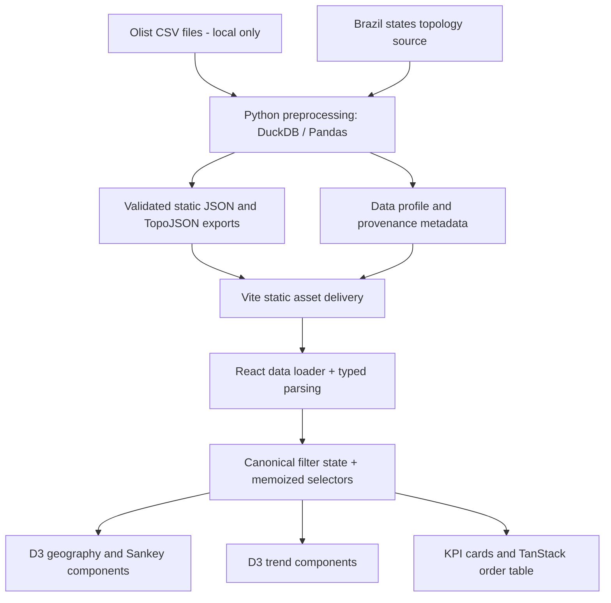

# Technical Architecture

## 1. Architecture in one sentence

A **static React/TypeScript single-page application** loads validated compact analytical exports prepared offline from Olist CSVs; **React owns application state and SVG rendering**, while D3 calculates chart scales and layouts.



## 2. Technology choices

| Concern | Choice | Reason |
|---|---|---|
| Language/UI | TypeScript, React, Vite | Type contracts, fast iteration, familiar portfolio stack |
| Styling | Tailwind CSS + CSS semantic tokens | Light/dark switch with dark default, including SVG chart tokens |
| Charts | D3 (`d3-scale`, `d3-shape`, `d3-array`, `d3-axis`, `d3-time-format` as needed) | Data-driven, custom linked charts |
| Geographic chart | `d3-geo`, `topojson-client`, TopoJSON | Lightweight 27-state geometry, no heavyweight basemap |
| Flow chart | `d3-sankey` | State-to-state weighted Sankey layout |
| Tables | `@tanstack/react-table` | Headless sorting/pagination/filtering |
| ETL | Python, DuckDB optional, Pandas optional | Reproducible joins, transformations, exports |
| Testing | Vitest, React Testing Library, Playwright only if time allows | Data tests and focused UI flows |
| Execution | Local Vite dev/preview | No deployment pipeline or production hosting in POC |

Use stable compatible published versions at implementation time and commit a lockfile; do not hardcode unverified latest versions in documentation.

## 3. Proposed folders

```text
commerce_dashboard/
  README.md
  docs/
    PRODUCT_AND_FEATURES.md
    ARCHITECTURE.md
    DATA_SPECIFICATION.md
    VISUALIZATION_AND_UX.md
    IMPLEMENTATION_PLAN.md
    TESTING_AND_ACCEPTANCE.md
    DECISIONS_AND_RISKS.md
  data/
    raw/                  # gitignored source downloads
    processed/            # optional local processing artifacts
  scripts/
    prepare_data.py
    validate_data.py
  public/
    data/                 # only approved, compact derived static artifacts
  src/
    app/                  # app initialization, shell, filters
    components/           # reusable UI pieces
    charts/               # BrazilMap, ShippingSankey, DeliveryTrends
    data/                 # loader, runtime validators, derived selectors
    domain/               # types, metrics, normalization
    features/orders/      # explorer and detail panel
    styles/
    main.tsx
  tests/
    fixtures/
  package.json
  vite.config.ts
```

Avoid creating all folders before they're used. `data/raw/` must be gitignored. Publishing derived records requires confirming source licensing/privacy and appropriate redistribution permissions; see decisions document.

## 4. Runtime flow and responsibility

1. **ETL** joins source tables by keys, computes durable derived attributes, validates rows, publishes reproducible exports and processing manifest.
2. **Loader** fetches static exports through `import.meta.env.BASE_URL`, verifies schema version, and surfaces loading/error states.
3. **Filter store** holds user-chosen purchase date interval, destination state, optional seller state, optional product category, and optional selected Sankey link. Prefer `useReducer` with typed actions at the app-shell level; Context is optional only if prop drilling becomes excessive.
4. **Selectors** determine eligible order IDs and eligible item rows. Return stable typed view models: KPI, regional, Sankey, time series, and order-table data. Use `useMemo` for aggregate derivation; no separate chart should independently redefine metrics.
5. **React visualization components** accept view-model props and `onSelect(...)` callbacks. Use D3 layout/scales; React creates the SVG DOM. Use `ref` and `useEffect` only for isolated transitions/measurement where needed.

**No separate backend, database server, Redux, TanStack Query, map tile service, WebSocket, Kafka or routing engine.**

## 5. Handling ~100k orders

- Prefer compact analytical rows rather than raw nested joins; numeric values should be typed/validated.
- Avoid loading the millions of duplicate geolocation rows at runtime; aggregate locations during ETL.
- Static summary files enable fast first paint; but **arbitrary cross-filtering requires sufficiently granular order/item data**. Either ship compact order/item data or restrict filtering transparently. Never pretend a pre-aggregated cube can answer a dimension it does not contain.
- A default **development fixture** may load 500–2,000 clearly labeled sampled orders; final acceptance should exercise the intended full processed cohort unless profiling requires a documented smaller scope.
- Lazy-load heavy order details if needed. Measure actual network transfer, heap and selector latency; only introduce Web Workers/Parquet-in-browser if testing exposes issues.
- Keep potentially sensitive raw source files out of public repository; minimize source identifiers in distributed artifacts if legal review raises concerns.

## 6. Local execution and theming

Run with `npm run dev` for development and `npm run build` then `npm run preview` for build validation. Use the Vite default root-relative base (`/`) and construct static data URLs using `import.meta.env.BASE_URL`; never hardcode a GitHub Pages repository path. No hosting workflow is required.

Apply a `data-theme="dark" | "light"` attribute to the document root and define semantic CSS custom properties for surfaces, text, borders, chart grids, color scales, and focus treatments. Tailwind styles should consume those variables. Dark is the first-visit default. The toolbar theme toggle changes the attribute and persists the selected theme to `localStorage` where available; handle storage access errors gracefully. Prevent an initial flash of the wrong theme if possible. All SVG charts should consume the same theme tokens and rerender legend/axis/text colors after theme changes. Theme affects presentation only, never filter data or analytics.

## 7. Contracts and design principles

- Dates: UTC/parsing must be explicit. Olist timestamps lack offsets; treat them as local source timestamps consistently and avoid browser timezone reinterpretation. Calendar-day comparisons are based on source dates, not local viewer timezone.
- Money: BRL, raw numeric units; format with `Intl.NumberFormat('en-US', {style:'currency',currency:'BRL'})`.
- Missing values: nullable in types; exclude from relevant denominators, count missingness in validation report.
- Provenance: data exports contain version, source filenames and timestamp range; never claim on-map arcs are roads.
- Rendering: aggregate to states and monthly buckets before D3; no per-order geographic SVG marks.
- Security: the local build's files are not automatically public, but the GitHub repository is public; keep raw/derived source data ignored until redistribution review. Exclude PII and unnecessary free-text fields. Escape text content through React, no `dangerouslySetInnerHTML` for data.
