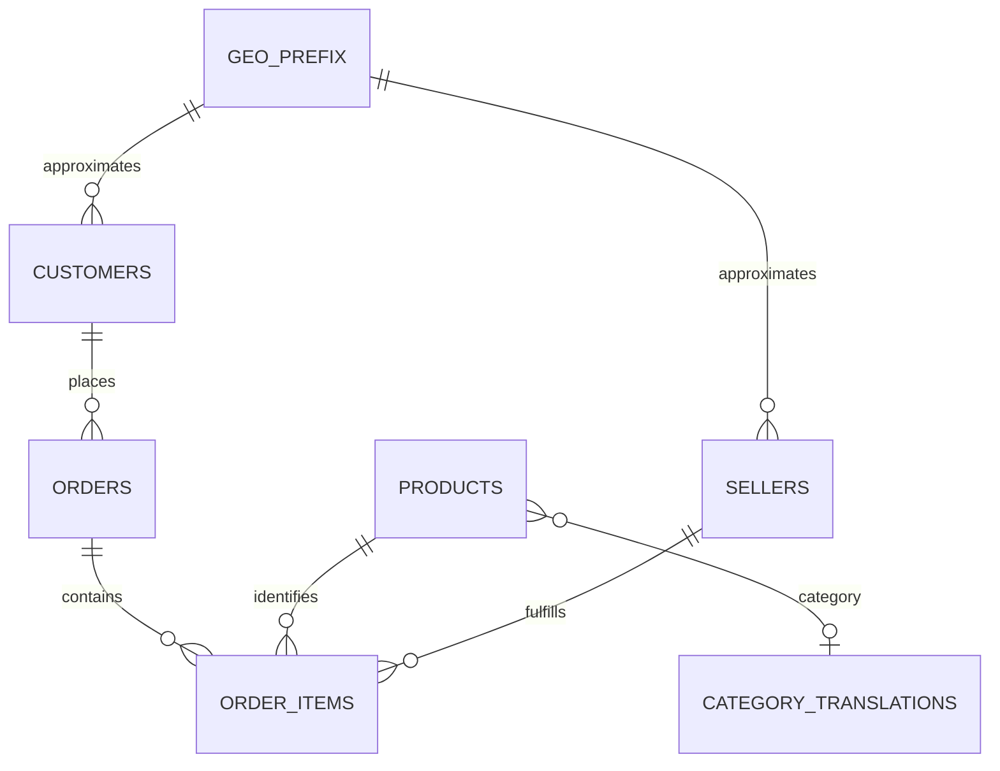

# Olist Data Specification and Analytical Semantics

> This is a **design contract based on the published Olist schema**. It is not a completed inspection of the actual downloaded CSV files. First implementation work must profile actual files and adjust documented assumptions before processing.

## 1. Source inputs

| Source CSV | Important fields | Use |
|---|---|---|
| `olist_orders_dataset.csv` | `order_id`, `customer_id`, `order_status`, `order_purchase_timestamp`, `order_delivered_customer_date`, `order_estimated_delivery_date`, `order_approved_at`, `order_delivered_carrier_date` | Purchase/delivery milestones; order grain |
| `olist_order_items_dataset.csv` | `order_id`, `order_item_id`, `product_id`, `seller_id`, `shipping_limit_date`, `price`, `freight_value` | Item grain; seller links; charges |
| `olist_customers_dataset.csv` | `customer_id`, `customer_unique_id`, `customer_zip_code_prefix`, `customer_city`, `customer_state` | Order destination region |
| `olist_sellers_dataset.csv` | `seller_id`, `seller_zip_code_prefix`, `seller_city`, `seller_state` | Item seller origin region |
| `olist_products_dataset.csv` | `product_id`, `product_category_name`, optional dimensions and weight | Category join |
| `product_category_name_translation.csv` | `product_category_name`, `product_category_name_english` | English names |
| `olist_geolocation_dataset.csv` | `geolocation_zip_code_prefix`, `geolocation_lat`, `geolocation_lng`, `geolocation_city`, `geolocation_state` | Optional approximate location centroids |

`olist_order_payments_dataset.csv` and `olist_order_reviews_dataset.csv` are not required for this POC. Do not infer actual shipping cost, carrier, vehicle location, or travel path from these files.

## 2. Relationship cardinality



- `orders.order_id` is unique in the source order table; order items are unique by (`order_id`, `order_item_id`).
- `orders.customer_id` joins customers' **order-specific** `customer_id`, not the cross-order `customer_unique_id`.
- One order can contain several items and several sellers; **never sum an order metric over item joins**.
- Geolocation prefixes appear many times. Aggregate coordinates once per prefix/state before joining (and validate state disambiguation); joining raw geolocation rows directly causes a many-to-many explosion.

## 3. Export model (contract v1)

### `orders.json` — order grain

```ts
interface OrderFact {
  orderId: string;
  customerState: string | null; // 2-letter Brazilian state code
  customerCity: string | null;
  purchaseDate: string | null; // YYYY-MM-DD from source timestamp
  purchaseTimestamp: string | null; // normalized source-local timestamp, no implied UTC
  estimatedDeliveryDate: string | null; // YYYY-MM-DD
  deliveredDate: string | null; // YYYY-MM-DD
  deliveredTimestamp: string | null;
  status: string;
  deliveryDays: number | null; // elapsed duration; purchase-to-delivery
  deliveryDayDelta: number | null; // calendar date(actual) - date(estimated)
  deliveryClassification: 'early' | 'on_time' | 'late' | 'unknown';
  itemCount: number;
  itemPriceTotalBRL: number;
  freightChargeTotalBRL: number;
}
```

### `items.json` — one order-item contribution

```ts
interface ItemFact {
  orderId: string;
  orderItemId: number;
  sellerId: string;
  sellerState: string | null;
  customerState: string | null;
  category: string; // translated, or explicit Unknown/Untranslated value
  priceBRL: number;
  freightChargeBRL: number;
}
```

No unnecessary product descriptions or PII should be published. Order IDs may be hashed or masked for public static distribution if source terms and privacy review warrant it, but the join key must remain stable.

### `geo-flows.json` — optional default-view optimization

A static preaggregation for fast first render, **not a substitute for item records under arbitrary filters**.

```ts
interface FlowAggregate {
  sellerState: string;
  customerState: string;
  category: string;
  itemCount: number;
  itemValueBRL: number;
  freightChargeBRL: number;
  distinctOrderCount: number; // distinct within this exact bucket ONLY
}
```

Do not sum bucket `distinctOrderCount` across categories or sellers to calculate total unique orders: a single order can appear in multiple buckets.

### `locations.json` and `brazil-states.topojson`

`locations.json` holds state codes, display names, and optional centroids (state centroid is preferred to unreliable post-code means for state-level drawing). The simplified licensed/reusable Brazil states topology uses the same 27 codes; validate all codes and shapes before build.

### `metadata.json`

```ts
interface DataManifest {
  schemaVersion: 1;
  sourceName: string;
  sourceFiles: string[];
  generatedAt: string;
  purchaseDateMin: string | null;
  purchaseDateMax: string | null;
  orders: number;
  items: number;
  exclusions: Record<string, number>;
  processingVersion: string;
  sampleMode: boolean;
  notes: string[];
}
```

## 4. Canonical filtering semantics

**Scope filters:** purchase date range is inclusive (`YYYY-MM-DD`), customer destination state, optional seller state, and English product category. Multiple filters combine with logical AND. Seller/category filters are evaluated on **item rows**, but orders are selected by existence of at least one qualifying item.

Algorithm:

1. `dateEligibleOrders` = orders with purchase date within selected range and (if selected) matching customer state.
2. `matchingItems` = item records linked to `dateEligibleOrders` and matching seller state/category criteria.
3. `eligibleOrderIDs` = distinct order IDs of `matchingItems`; if no item filters are selected, use `dateEligibleOrders` (including records without item rows, clearly marked if present).
4. **Order-level KPIs and delivery trend** calculate once per `eligibleOrderIDs`.
5. **Item-level freight/value and Sankey** use `matchingItems` for those `eligibleOrderIDs`; if no item filters, all linked item contributions.
6. **Map** counts destination orders **distinctly**, and delivery rates by order; use the current eligible orders. Sankey link metrics reflect matching item contributions, not unique journeys.
7. **Order explorer** lists distinct eligible orders and allows expanding all items or just matched items with an explicit view toggle.

**Cross-filtering special case:** when a Sankey link is clicked, seller state and customer state become filters. A clicked link's item set must be the same set underlying the Sankey and corresponding order drill-through. Don't allow component-specific hidden filters.

### Crucial product-filter example

Order X contains two electronics items from seller SP and one furniture item from seller RJ, all shipping to customer MG. Selecting electronics yields **one** order, **two** matching item contributions, and the sum of electronics freight/price only. Selecting furniture yields **one** order and the RJ->MG flow. Selecting all categories yields **one** order for KPI totals; the Sankey can include both SP->MG and RJ->MG links.

## 5. Canonical metric definitions

| Metric | Numerator / calculation | Population / denominator | Notes |
|---|---|---|---|
| Total orders | Count unique order IDs | Eligible orders with valid ID, optional purchase date range eligibility | State clearly if no date excludes unparseable dates |
| Delivered eligible | Count orders with status `delivered` and valid purchase + actual delivery timestamps | Eligible orders | Valid durations must be >= 0 |
| On-time rate | Count delivered eligible with actual **calendar date** <= estimated **calendar date** | Delivered eligible with valid estimated date | Inclusive estimated delivery *day*, not midnight timestamp comparison |
| Delivery duration | `(delivered_customer - purchase_timestamp)` in days | Delivered orders with valid coherent timestamps | It is **purchase-to-delivery**, not carrier transit |
| Median / P95 | Exact percentile over valid `deliveryDays` | Same valid delivered cohort | Define percentile interpolation in `metrics.ts` and replicate in ETL tests |
| Early/on-time/late | Actual date <, =, > estimated date | Delivered with valid actual + estimate | If comparing estimated date directly, late is date after estimate |
| Freight ratio | `sum(item.freight_value) / sum(item.price)` | Eligible matching items with valid amounts; denominator > 0 | BRL charged to customers, **not logistics costs** |
| Average freight/order | `sum(item.freight_value) / distinct eligible orders` | Eligible cohort; label whether empty-item orders are included | Prefer no ambiguous presentation initially |
| Monthly volume | Distinct orders grouped by purchase month | Eligible orders with valid purchase date | Historical purchase cohorts |
| Trend punctuality | On-time rate of eligible delivered orders grouped by **purchase month** | Estimated/actual valid delivered orders in that month | May have a small cohort right edge; disclose |

Financial totals use numeric BRL, rounded only for display. Reject nonfinite numeric values; don't silently turn null into zero. `deliveryDayDelta` may be negative, zero, positive; missing estimated or actual yields unknown. Distinguish **late** (> estimated calendar date) from **delayed shipping milestone** (not reliably supported).

## 6. ETL and validation

- Inspect file count, column names, row counts, uniqueness, null percentages, status frequencies, timestamp ranges, and expected joins **before** writing transformation code.
- Validate all CSV input schemas and per-file key uniqueness expectations. Duplicate order/item keys, unparseable money, malformed state codes, negative prices/freight, and impossible dates must be counted and surfaced.
- Join category translation by Portuguese category, fall back deterministically to source category or `Unknown`; never invent translations.
- For geolocation, only retain plausible Brazil coordinates; choose median coordinates per (`prefix`, `state`) after outlier handling. Where a prefix has inconsistent states, report and avoid a silently ambiguous match.
- Generate deterministic stable sort order and output checksums/manifest. The ETL must be idempotent for the same input; timestamp in metadata is permitted to vary separately from deterministic content.
- Preserve full precision for calculations and format in UI.
- Do not commit raw CSVs or any large processed record export until redistribution permission is established. The repository is public even though the POC runs locally.

## 7. Data discovery open questions (must resolve in first stage)

- Are all seven expected source files present and correct?
- How many orders/items have missing or incoherent timestamps?
- Are any seller/customer state values unrecognized?
- How many untranslated categories?
- What is the runtime compressed size of full compact `orders.json` and `items.json`? Does lazy loading improve first interaction?
- What exact TopoJSON source, license, and state code mapping will be used?
- Are source dataset and derived exports redistributable under their terms? For this local-only POC keep source and unapproved processed data outside Git; assess public distribution only if hosting is later requested.
