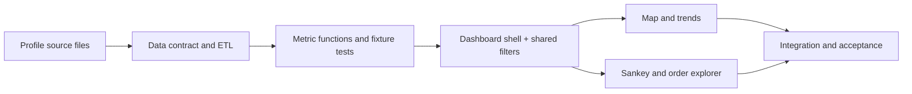

# Two-Day Implementation Plan

## Strategy

Make the dashboard **demonstrably useful as early as possible**. Deliver in three short phases, not a 14-WU infrastructure plan. Target is roughly two development days **if dataset access, compatible tooling, and testing go smoothly**; no guarantee. Favor completing one reliable cross-filtered vertical slice over implementing many partially connected chart features.

Do not start application implementation before inspecting actual Olist inputs and confirming the data export/license strategy.

## Stage 0 — Dataset access and profiling (initial gate)

**Input:** Olist original downloaded CSVs. No GitHub write is necessary until the project owner approves the selected data-distribution strategy.

- [ ] Obtain the seven selected CSVs listed in `DATA_SPECIFICATION.md`.
- [ ] Profile columns, unique keys, row counts, missing delivery dates, unknown states, category translations, date range, and duplicate geolocation prefixes.
- [ ] Confirm metric semantics and document exact ETL decisions in a small processing report.
- [ ] Identify TopoJSON source/license and state-code mapping.
- [ ] Decide public artifact licensing: committed derived data vs code-only ETL plus safe demo fixture.

**Exit gate:** Source schema/profile recorded; no unresolved key join assumptions; data redistribution policy documented.

## Stage 1 — Data pipeline and app skeleton

**Goal:** Real, validated Olist-based data accessible in a browser with correct KPI outputs.

- [ ] Initialize Vite React TypeScript, styling, testing and build tooling; lock dependencies.
- [ ] Set GitHub Pages `base` and public asset paths correctly.
- [ ] Implement `scripts/prepare_data.py` (DuckDB or Pandas for joins), output order/item facts, optional initial flow summary, location/state topology, and data manifest.
- [ ] Add schema verification and a processing report (counts, nulls, unmatched foreign keys, translations, invalid geography, excluded dates).
- [ ] Create explicit typed domain models and shared metric functions.
- [ ] Implement static loader and no-data/error/loading UI.
- [ ] Build shell, filter bar and four KPI cards with correct denominators.
- [ ] Tests for multi-item order arithmetic, date cutoff inclusion, missing outcomes and zero-denominator behavior.

**Deliverable:** App runs locally, source data loads, and filtered KPI values are testably correct.

**Stop rule:** If real data cannot be publicly redistributed, publish a clearly labeled non-Olist public fixture and retain local ETL instructions. Do not silently substitute synthetic records as real Olist data.

## Stage 2 — Interactive D3 dashboard

**Goal:** A polished linked analysis workflow.

- [ ] Prepare validated Brazil states TopoJSON; build D3 choropleth with selectable state and alternate metric.
- [ ] Build monthly D3 trend chart with tooltips and simple date selection (brushing optional if available without delay).
- [ ] Build `d3-sankey` with item contribution weights and top-N readability rule.
- [ ] Implement TanStack Table explorer and detailed order panel.
- [ ] Wire shared filter actions/selectors and visible filter chips/reset.
- [ ] Validate chart/table/KPI agreement on explicit fixtures.

**Deliverable:** Complete workflow: select state/category/date, inspect Sankey and metrics, drill down to supporting orders, clear filters.

**Stop rule:** Prefer fewer fully correct charts over cosmetic transitions or extra chart modes. If full-data Sankey is unreadable, cap to top-N, show displayed flow share and provide table drill-through.

## Stage 3 — QA, polish, deployment

**Goal:** Stable demo and credible handoff.

- [ ] Test with complete processed dataset or document any deliberate sample size.
- [ ] Run type-check, lint, unit tests and production build.
- [ ] Validate visual states (all, one state, one category, narrow dates, empty, missing).
- [ ] Check desktop, tablet/mobile, keyboard controls and responsive chart sizing.
- [ ] Confirm displayed metrics against independently computed data samples.
- [ ] Test GitHub Pages path and all static data requests under `/commerce_dashboard/`.
- [ ] Write concise setup, data acquisition, licensing, and deployment instructions in README.
- [ ] Tag or mark P0 accepted only after release gate in `TESTING_AND_ACCEPTANCE.md`.

**Deliverable:** Buildable, documented and testable POC that can be hosted statically.

## Dependency order

## Suggested issue/commit boundaries (optional)

1. `chore: establish app foundation and data contracts`
2. `feat: prepare and validate Olist analytical facts`
3. `feat: add dashboard KPIs and shared filters`
4. `feat: add D3 map and monthly trends`
5. `feat: add Sankey and order explorer`
6. `test: verify integrated dashboard and static build`

These are **logical checkpoints**, not mandatory separate Codex Work Units. They may be completed directly through normal ChatGPT/GitHub editing if convenient.

## Resource guardrails

- One page, no server runtime, no geospatial tile stack, no charting framework alongside D3 by default.
- No live APIs or authenticated service connections.
- No custom D3 DOM lifecycle framework.
- No excessive dependency/version work: choose compatible stable packages once, install, commit lockfile.
- No extra exploration projects or new dashboards during P0.
- If deadline becomes tight, cut: period-comparison chips, P95 toggle, advanced animation, Sankey measure switching, complex date brush **before** cutting correctness or linked filtering.

## Definition of done

The P0 workflows in `PRODUCT_AND_FEATURES.md` and `TESTING_AND_ACCEPTANCE.md` all pass; deployed/static build labels its data truthfully; code and docs are reproducible; remaining enhancement gaps are explicitly marked as non-blocking.
